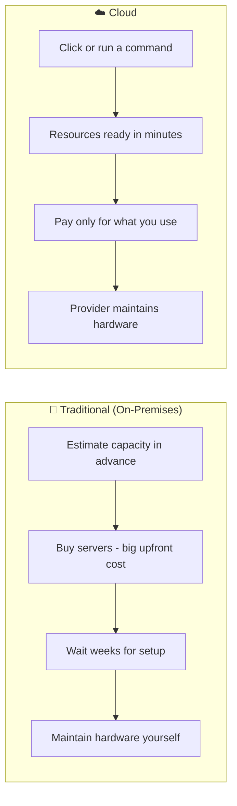
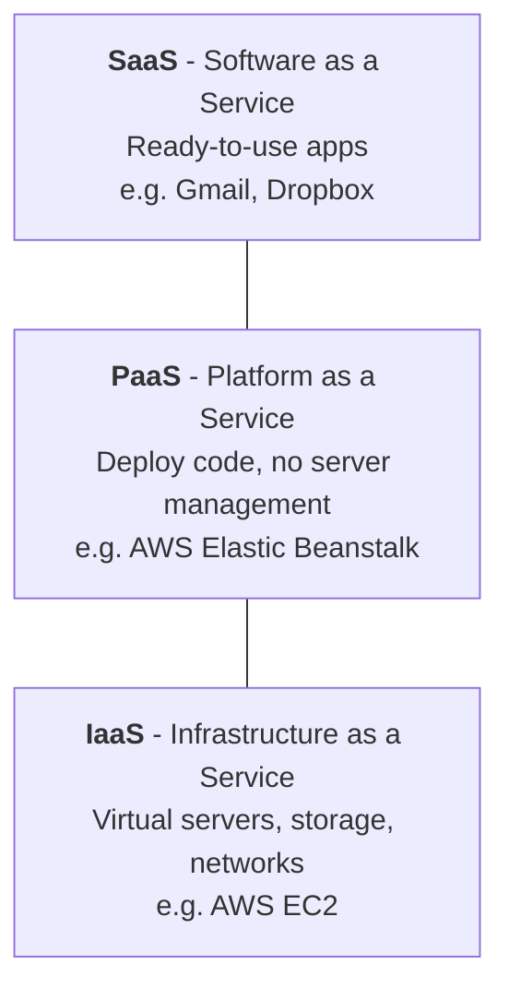
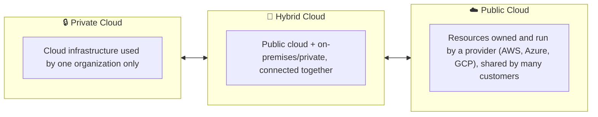
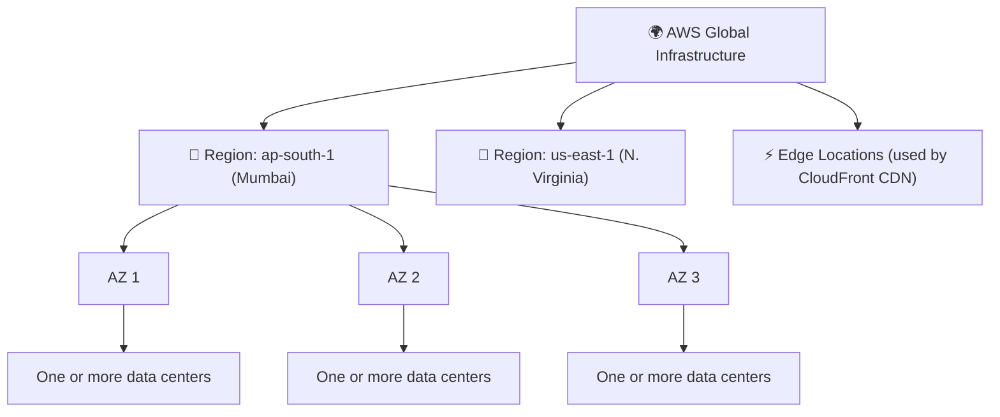

# ☁️ 01 – Cloud Computing Basics

> **Part of:** AWS SAA-C03 Study Journey
> **Date:** `<DD Month YYYY>`
> **Source:** `<paste YouTube video link + timestamp>`
> **Time spent:** `<x hours>`

---

## 1. What is cloud computing?

**Cloud computing** means renting computing resources (servers, storage, databases, networking, software) over the internet and paying only for what you use, instead of buying and maintaining your own hardware.

**Simple analogy:** Owning a data center is like owning a car. Cloud is like using Uber: you pay per ride, and someone else handles the maintenance.

### Traditional IT vs Cloud

| | Traditional | Cloud |
|---|---|---|
| **Cost model** | Large upfront purchase (CapEx) | Pay-as-you-go (OpEx) |
| **Setup time** | Weeks to months | Minutes |
| **Scaling** | Buy more hardware | Scale up or down on demand |
| **Maintenance** | Your team | Cloud provider |

---

## 2. The 6 advantages of cloud computing (AWS's list)

1. **Trade fixed expense for variable expense:** no upfront data center cost; pay for what you consume.
2. **Benefit from massive economies of scale:** AWS buys at huge volume, so prices per unit are lower.
3. **Stop guessing capacity:** scale up or down as demand changes.
4. **Increase speed and agility:** new resources in minutes, so experiments are cheap.
5. **Stop spending money running data centers:** focus on your product, not on racks and cables.
6. **Go global in minutes:** deploy close to users around the world.

---

## 3. Cloud service models: IaaS, PaaS, SaaS

*The lower you go, the more control you have, and the more work you do.*

### Who manages what?

| Layer | On-Premises | IaaS | PaaS | SaaS |
|---|:---:|:---:|:---:|:---:|
| Application | You | You | You | Provider |
| Data | You | You | You | You |
| Runtime | You | You | Provider | Provider |
| Operating System | You | You | Provider | Provider |
| Virtualization | You | Provider | Provider | Provider |
| Servers | You | Provider | Provider | Provider |
| Storage | You | Provider | Provider | Provider |
| Networking | You | Provider | Provider | Provider |

> 💡 **Remember:** you always stay responsible for your **data** and who can access it. This idea leads into the AWS **Shared Responsibility Model** (to be covered in the IAM/Security notes).

**Serverless (Lambda, etc.):** you only upload code and the provider runs it on demand. Think of it as an even more hands-off form of PaaS.

---

## 4. Cloud deployment models

| Model | Who uses it | Typical reason |
|---|---|---|
| **Public** | Anyone | Low cost, fast start, huge scale |
| **Private** | One organization | Strict control or compliance needs |
| **Hybrid** | Mix of both | Keep sensitive data on-site, use cloud for everything else |

---

## 5. AWS Global Infrastructure

AWS is built from **Regions**, **Availability Zones (AZs)**, and **Edge Locations**.

| Term | Meaning |
|---|---|
| **Region** | A separate geographic area (e.g. Mumbai) containing multiple AZs |
| **Availability Zone (AZ)** | One or more data centers in a Region with independent power and networking; AZs in a Region are connected by fast, low-latency links |
| **Edge Location** | A site used to cache content closer to users (CloudFront) |

### Why this matters for architecture

- **Spread across multiple AZs** → if one data center has a problem, your app keeps running (**high availability**).
- **Choose a Region** based on: latency to users, legal/data rules, service availability, and cost.

---

## 6. Key terms (quick glossary)

| Term | One-line meaning |
|---|---|
| **Scalability** | Ability to handle growth by adding resources |
| **Elasticity** | Automatically scaling up *and down* with demand |
| **High availability** | System stays up even when parts fail |
| **Fault tolerance** | System keeps working with no interruption when a component fails |
| **Latency** | Delay between a request and a response |
| **Pay-as-you-go** | Pay only for the resources you actually use |

---

## 7. Self-check questions (answer in your own words)

1. What is the difference between CapEx and OpEx?
2. Which service model (IaaS / PaaS / SaaS) gives you the most control?
3. Why would a company choose a hybrid cloud?
4. What is the difference between a Region and an Availability Zone?
5. Why is it a good idea to deploy across more than one AZ?

---

## 8. My doubts / things to revisit

- [ ] _write anything confusing here_
- [ ] _..._

## 9. Key takeaways

- _write 3 to 5 points in your own words_

---

⬅️ [Back to README](../README.md)
