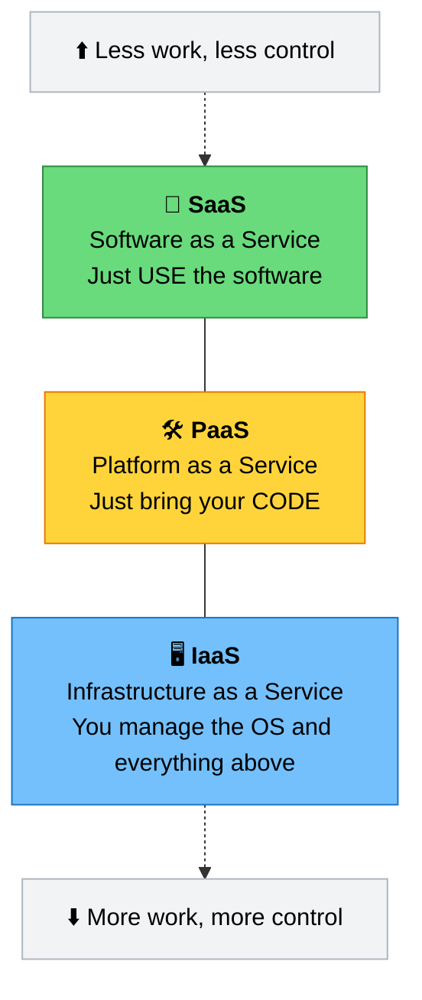
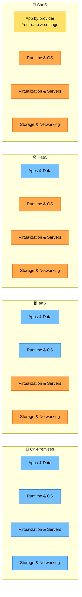
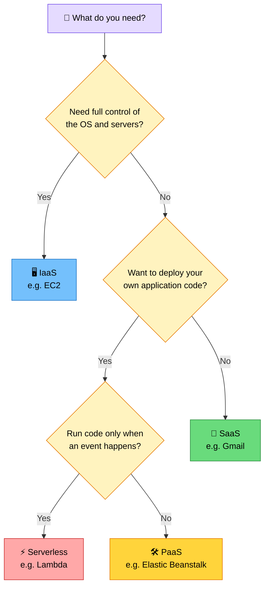
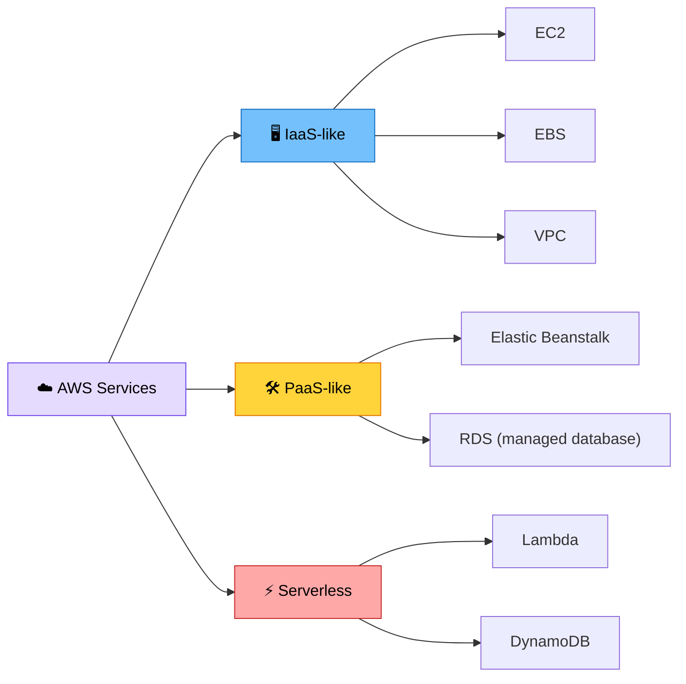

# 🎨 02 – IaaS, PaaS & SaaS

> **Part of:** AWS SAA-C03 Study Journey
> **Date:** `<DD Month YYYY>`
> **Source:** `<paste YouTube video link + timestamp>`
> **Time spent:** `<x hours>`

---

## 1. The big picture

Cloud services come in different **levels of control**. The more the provider handles for you, the less work you do, but the less you can customize.

---

## 2. Who manages what?

🟦 **Blue** = you manage it · 🟧 **Orange** = the provider manages it · 🟨 **Yellow** = shared (provider runs the app, you control your data and settings)

---

## 3. Each model in detail

### 🖥️ IaaS – Infrastructure as a Service

The provider gives you the basic building blocks: virtual servers, storage, and networks. **You** install and manage the operating system, runtime, and applications.

- **Control:** very high
- **Your job:** OS patching, security updates, software installs, scaling setup
- **Good for:** custom setups, migrating existing apps ("lift and shift"), full control over the environment
- **AWS examples:** **Amazon EC2**, EBS (block storage), VPC (networking)

### 🛠️ PaaS – Platform as a Service

The provider manages the servers *and* the OS and runtime. **You** just deploy your code and manage your data.

- **Control:** medium
- **Your job:** write and deploy the application
- **Good for:** developers who want to ship fast without managing servers
- **AWS examples:** **AWS Elastic Beanstalk** (upload your code and AWS sets up the environment)

### 📱 SaaS – Software as a Service

A complete, ready-to-use application delivered over the internet. You don't install or maintain anything.

- **Control:** low (only your data and settings)
- **Your job:** use the software
- **Good for:** everyday tools, email, office work, collaboration
- **Examples:** Gmail, Dropbox, Microsoft 365, Zoom (AWS has Amazon WorkMail and Amazon Chime-style services, though SaaS is more about third-party software)

### ⚡ Bonus: Serverless / FaaS (Function as a Service)

You write small functions and the provider runs them **only when triggered**. You never think about servers, and you pay only while your code runs.

- **AWS example:** **AWS Lambda**
- It sits close to PaaS, with even less to manage.

---

## 4. Real-life analogy: Pizza as a Service 🍕

| Model | Pizza version | What you do |
|---|---|---|
| **On-Premises** | Make pizza at home | Buy everything, cook it, serve it, clean up |
| **IaaS** | Take-and-bake | Someone gives you the oven and ingredients, you bake it yourself |
| **PaaS** | Pizza delivered | The pizza arrives ready, you just bring your own drinks and eat |
| **SaaS** | Dining at a restaurant | Everything is done for you, you just enjoy it |

---

## 5. Comparison table

| | IaaS | PaaS | SaaS |
|---|---|---|---|
| **Stands for** | Infrastructure as a Service | Platform as a Service | Software as a Service |
| **You manage** | OS, runtime, apps, data | Apps, data | Data and settings only |
| **Provider manages** | Hardware, virtualization, networking | Everything under your app | Everything except your data |
| **Control** | 🟢🟢🟢 High | 🟡🟡 Medium | 🔴 Low |
| **Ease of use** | Harder | Easier | Easiest |
| **Best for** | Admins, custom setups | Developers | End users |
| **Example** | EC2 | Elastic Beanstalk | Gmail |

---

## 6. Which one should I choose?

---

## 7. Mapping to AWS (exam-style thinking)

> ⚠️ **Note:** AWS doesn't officially label every service as IaaS/PaaS/SaaS. The grouping above is a way of thinking about *how much AWS manages for you*. Some services sit between categories.

### Handy exam links to remember

- **EC2:** you patch and manage the guest OS.
- **RDS:** AWS manages the database server, OS patching, and backups; you manage your data and database settings.
- **Lambda:** you only provide code, and AWS manages the servers.

*(This ties into the AWS **Shared Responsibility Model**; I'll add details in the security notes.)*

---

## 8. Self-check questions (answer in your own words)

1. Which model gives you the most control, and what is the price of that control?
2. A developer wants to deploy a web app without managing servers. Which model fits best?
3. Is Gmail IaaS, PaaS, or SaaS? Why?
4. In IaaS, who patches the operating system?
5. How is Serverless (Lambda) different from IaaS (EC2)?

---

## 9. My doubts / things to revisit

- [ ] _write anything confusing here_
- [ ] _..._

## 10. Key takeaways

- _write 3 to 5 points in your own words_

---

⬅️ [Previous: Cloud Computing Basics](01-cloud-computing-basics.md) · [Back to README](../README.md)
